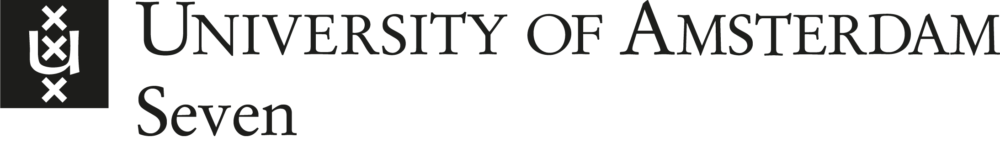

    

The <a href="https://ias.uva.nl">Institute for Advanced Study</a> provides in-kind support by hosting ACSCC and providing lunch. They also generously contribute to fund travel grants and additional fee waivers as part of their <a href="https://ias.uva.nl/community/ias-next/ias-next.html">IAS NEXT</a> initiative.

    

<a href="https://seven.uva.nl/en">SEVEN</a>, the University of Amsterdam's interdisciplinary climate institute, generously contributes to fund travel grants and fee waivers to help make ACSCC as inclusive as possible.
