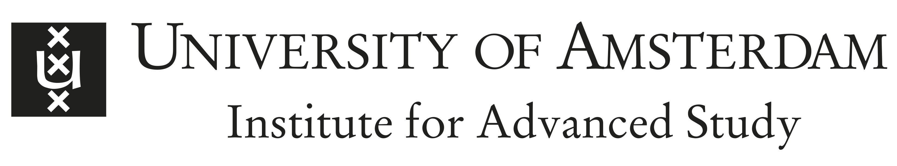

    

The Institute for Advanced Study provides in-kind support by hosting ACSCC and providing lunch. They also generously contribute to fund travel grants and additional fee waivers as part of their <a href="https://ias.uva.nl/community/ias-next/ias-next.html">IAS NEXT</a> initiative.

<a href="https://seven.uva.nl/en">SEVEN</a>, the University of Amsterdam's interdisciplinary climate institute, generously contributes to fund travel grants, fee waivers, and social events.
